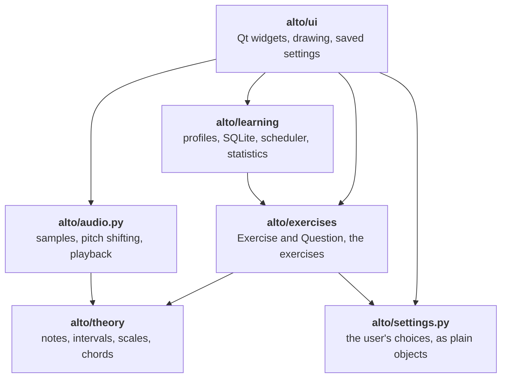
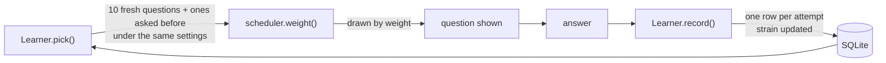
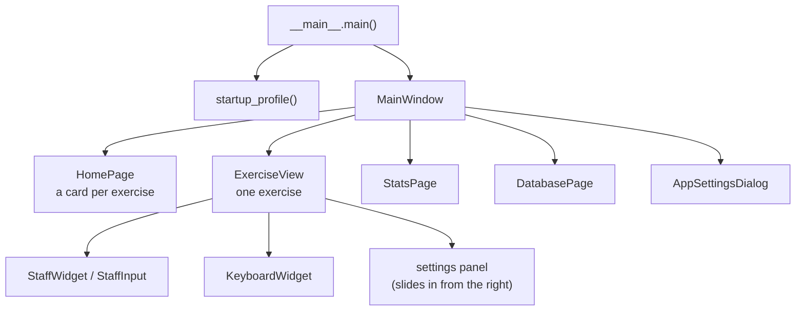

# Architecture

Alto is a desktop music theory trainer written in Python with PySide6 (Qt). It asks questions (name this note, read this key
signature, place this note on the staff ...), notices which ones you find hard, and asks those more often.

This page explains how the pieces fit together. For the long explanation, with the background ideas and reading lists, see the [developer guide](docs/guide/index.md). For every public class and function, see the [API reference](docs/api/index.md), which is written from the docstrings. For how to
run the tests, add an exercise or an instrument, and the coding rules, see [docs/development.md](docs/development.md).

## The big idea

Four layers, with Qt kept out of everything but the top one:

| Layer | Qt? | Knows about |
|---|---|---|
| `alto/theory/` | no | nothing else |
| `alto/settings.py` | no | `theory` |
| `alto/exercises/` | no | `theory`, `settings` |
| `alto/learning/` | no | `exercises` (to store and replay `Question`s) |
| `alto/audio.py` | yes (`QSoundEffect`) | `theory` |
| `alto/ui/` | yes | everything |

Nothing below `ui` imports `ui`. That is what lets the theory, the exercises and the scheduler be tested without a display,
and lets a new exercise appear in the app without any new interface code.

## Theory (`alto/theory/`)

`pitch.py` has `Note` (a letter, an accidental and an octave, so C♯ and D♭ are different notes) and `Interval`. `scales.py`
builds scales, modes, key signatures and chords from spelled intervals. Everything is plain Python and spelling is always
correct, which the exercises and the notation drawing both rely on.

## Settings (`alto/settings.py`)

One small object per exercise that has settings (`NoteNameSettings`, `KeyboardSettings`, `ConstructionSettings`,
`ArpeggioSettings`, `KeySignatureSettings`), each held as a module-level singleton: `settings.note_names`,
`settings.keyboard`, and so on. They hold only data and the rules about it, such as which clefs are active and what range
each clef allows.

Nothing in this module saves anything. Persistence lives in `alto/ui/settings_panel.py`, which has a `load_*` and `save_*` pair
for each object. The window loads them all at start-up and each panel saves after every edit.

## Exercises (`alto/exercises/`)

Two classes in `base.py` are the whole interface between the exercises and the rest of the app:

- **`Question`** says everything needed to show and mark one question: a prompt, the answer buttons, the notes to draw (or a
  keyboard key to highlight, or a note to place), the clef, a key signature, an explanation. It serializes with
  `to_dict`/`from_dict`, and `item_key()` gives it a stable 20-character identity, so the same question can be recognised
  when it comes round again.
- **`Exercise`** has a `name`, a `category`, a `description`, a `par_seconds` (how long a good first answer takes) and
  `generate(rng)`, which returns a `Question`. An exercise that reads settings overrides `settings_signature()`, so stored
  questions are only replayed while those settings are unchanged.

`library.py` holds the eight exercises: note names, interval names, key signatures, scale degrees, chord qualities, arpeggio
names, keyboard notes and note construction. Each is decorated with `@register`, which adds it to `REGISTRY` next to the
others of its category. The home screen and the sidebar are built from `REGISTRY`, so a new exercise shows up everywhere on
its own.

Exercises draw their questions from the current settings objects when `generate` runs. Changing a setting therefore takes
effect on the next question, with nothing to notify.

## Learning (`alto/learning/`)

This is what makes Alto adaptive. It is pure Python, and the database is the only place anything is stored.

- **`database.py`** is a SQLite store with three tables. `profiles` is a name with its own history. `attempts` has one row per
  answer given, wrong ones included, with the time it took. `items` has one row per question per profile: its `strain`, how many
  times it was seen and missed, the settings signature it was asked under, and the `Question` itself as JSON so it can be
  asked again. Deleting a profile deletes its history.
- **`scheduler.py`** turns a question's history into how soon it comes back. Each question has a *strain*, how much practice it
  needs. A wrong answer raises it, a first-try right answer lowers it, and the speed of the first answer against
  `par_seconds` moves it either way. The chance of being asked is `exp(slope * strain)`, damped for questions seen recently.
- **`learner.py`** ties a profile, the database and the scheduler together. `pick()` generates fresh questions, adds stored ones
  from the same exercise and settings signature, and draws one by weight. `record()` writes the attempt and updates the strain.
- **`stats.py`** works the numbers for the statistics screen out of the attempts: counts per period, accuracy, median time,
  the heatmap of reviews and the hardest questions.

A profile is just a name. There are no passwords and nothing leaves the machine.

## Audio (`alto/audio.py`)

Notes are played from recordings of real instruments (University of Iowa samples) in `alto/assets/samples/<instrument>/`. A
global `Sounds` object loads and caches `QSoundEffect`s on demand. Where an instrument has no recording for a note, it takes the
nearest recording and shifts the pitch (`shift_pitch`). Sustained instruments fade out as the next note begins. The piano is
the Salamander Grand Piano (`alto/assets/piano/`, a recording every minor third from A0 to C8), and notes outside that range are
synthesised in code (`synth_piano`).
`instrument_info.py` holds the facts shown about each
instrument's recordings.

## The interface (`alto/ui/`)

### Windows and screens

`MainWindow` has an exercise list on the left (which collapses) and a stack of pages on the right: the start screen, one
`ExerciseView` per opened exercise, and the statistics or database page shown over them. `__main__.main()` creates the
`QApplication`, applies the saved theme, opens the database in the user's data folder, asks for a profile name the first time,
and runs the event loop.

### One question, start to finish

`ExerciseView` is the screen for one exercise. It only ever works with `Exercise` and `Question`:

1. `next_question()` asks `Learner.pick()` for a question and draws it: a staff, a keyboard or only text, and the answer
   buttons the `Question` asks for.
2. An answer goes to `submit()`, which marks it with `Question.check()`, flashes the button, and calls `_record()`.
3. `_record()` times the answer from the question appearing (or the previous attempt) and passes it to `Learner.record()`. Only
   the first attempt counts towards the score and streak.
4. A right answer plays a sound (unless the sound is off, or the exercise has none) and the next question follows. A wrong one
   lets you try again.

The settings panel for the exercise is built by `settings_panel_for(exercise)`. Its `changed` signal is connected to
`next_question`, so an edit applies immediately.

### Drawing

Everything is drawn with `QPainter`, not made from images, so it scales and follows the theme.

- **`staff.py` and `staff_input.py`** draw the staff, clefs, key signatures and notes, and the clickable staff for placing
  a note. **`keyboard.py`** draws a piano to real proportions, and a miniature of all 88 keys for choosing a range.
- **`engraving.py`** loads the SMuFL music fonts in `alto/assets/fonts/` (Bravura, Leland and others) and reads their
  metrics, so noteheads, stems and clefs are engraved the way each font intends. **`notation.py`** is the choice of font and the
  baritone clef style. **`keyboard_styles.py`** is the keyboard's look, with a builder for custom colours.
- **`pictures.py`** holds the small illustrations in the settings panes: clefs, note values, key signatures and ranges.
  **`charts.py`** has the statistics charts, **`icons.py`** the tinted SVG icons, **`style.py`** the application stylesheet
  and **`theme.py`** the light, dark or system colour scheme.

`notation.py` and `keyboard_styles.py` must repaint what is on screen when the style changes, but the staff and keyboard
modules import them, not the other way round. So they call hooks that `staff.py` and `keyboard.py` register at import
(`on_redraw`).

### Saved settings

`store.py` is a thin layer over `QSettings` (the organisation and application are both "alto"). The window and the panels read
and write through it. The theme, notation font, keyboard style, instrument and the exercise settings are all saved there, not
in the database. Changing the theme builds a fresh `MainWindow` (`rebuild()`) so every icon and colour is drawn again.

## Where things are stored

| What | Where |
|---|---|
| Profiles, answers, per-question history | `alto.db` in the user's data folder, from `QStandardPaths` (`AppDataLocation`) |
| Theme, notation font, keyboard style, instrument, exercise settings, sidebar width and state | `QSettings("alto", "alto")` |
| Fonts, instrument recordings, icons | `alto/assets/`, shipped with the package |

Both stores go into a backup (Export backup… and Import backup… in the menu): one `.altobackup` zip holding the database, the
preferences and a checksummed manifest, written by `alto/learning/backup.py`. Importing replaces everything, so a clean install
comes up exactly as the backup was made.

## Tests

`pytest` runs the tests in `tests/` and the `>>>` examples in every docstring in `alto/`, so the examples cannot go out of date.
The root `conftest.py` gives each doctest a `QApplication` as `app` and points the settings and data folders at a throwaway
directory. `tests/conftest.py` does the same for the tests, closes every window and database a test leaves open, and turns sound
off. Widget tests use Qt's offscreen platform, so no display is needed. `tests/test_docstrings.py` checks that every module,
class and function has a complete NumPy-style docstring.

The lint and type checks (Ruff, Pyright) and the pre-commit and pre-push hooks are described in
[docs/development.md](docs/development.md).
