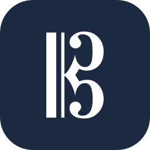
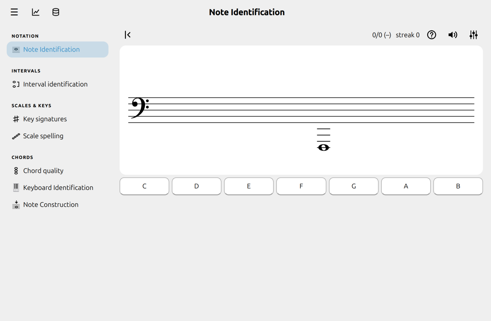
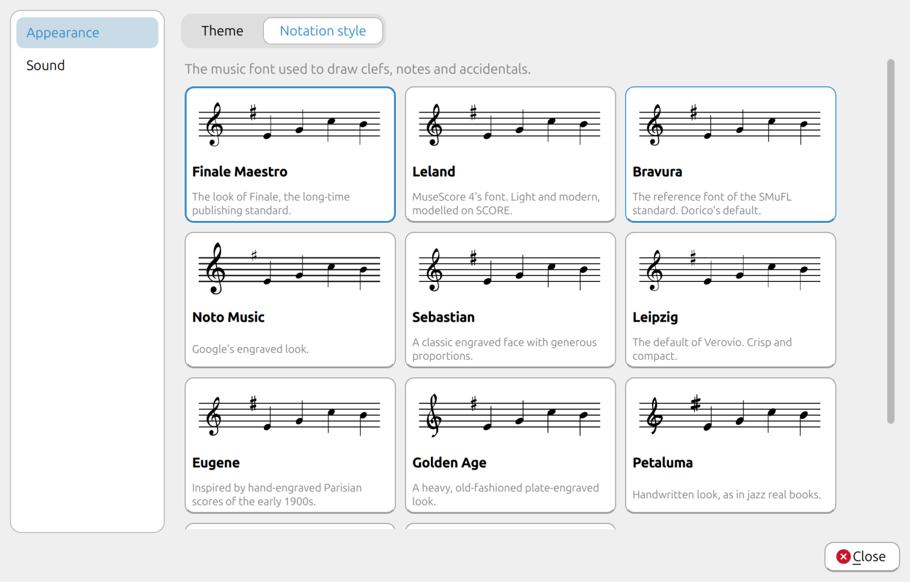
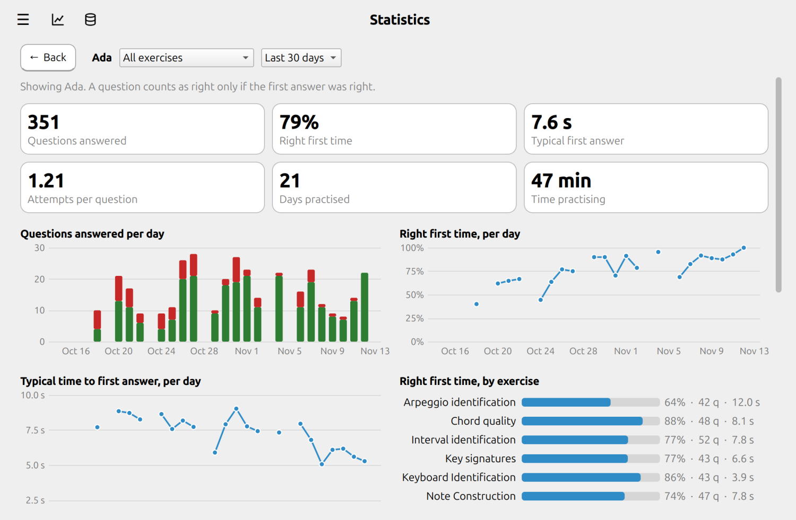
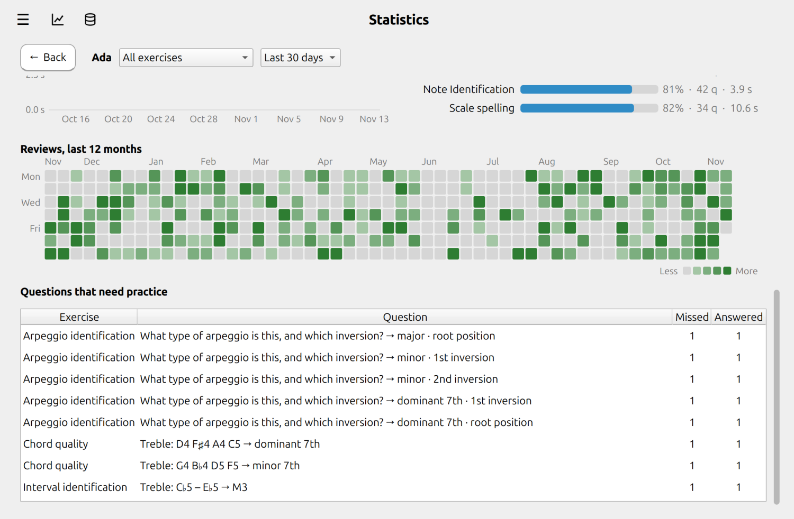

#  Alto

[](https://github.com/genedan/alto/actions/workflows/tests.yml)
[](https://codecov.io/gh/genedan/alto)
[](https://github.com/genedan/alto/actions/workflows/pyright.yml)
[](LICENSE)
[](https://genedan.github.io/alto/)
[](https://github.com/genedan/alto/blob/main/.github/workflows/tests.yml)

**Music theory practice for the Linux desktop that remembers what you get wrong.**

Alto is a free music theory trainer. Read notes on any clef, name intervals, chords and arpeggios, spell scales, learn key
signatures, find keys on a keyboard. It uses spaced repetition to optimize the learning process by feeding you problems that you find more challenging, and skipping over ones that are already easy.

<p align="center">
  <picture>
    <source media="(prefers-color-scheme: dark)" srcset="docs/assets/img/note-identification-dark.png">
    
  </picture>
</p>

## Make it yours

Almost everything is adjustable.

- **Notation in the font you like.** Eleven music fonts, from the polished look of Finale Maestro, Leland and Bravura to
  handwritten jazz styles. Every staff in the app follows your choice.
- **Light, dark or follow your desktop.** The theme switches instantly.
- **Practise exactly what you need.** Choose the clefs (treble, bass, alto, tenor or the grand staff), the range of
  notes, the key signatures, the note values from the breve to the thirty-second note, letter or solfège names, and
  whether sharps, flats and naturals appear.
- **Choose the sound.** Pick the instrument that plays your answers.

<p align="center">
  <picture>
    <source media="(prefers-color-scheme: dark)" srcset="docs/assets/img/settings-dark.png">
    
  </picture>
</p>

## It remembers what you get wrong

Every answer goes into a local database under your profile. Alto scores each question by how hard you find it:

- **Wrong answers count against it.** Every extra attempt pushes the question higher, so it returns more often.
- **Speed counts too.** A slow answer is held against a question, even when it is right. A very quick one earns it a
  rest.
- **Your progress is visible.** Charts show your accuracy, speed and volume over time, a calendar heatmap shows a year of
  practice at a glance, all filtered by exercise, and a read-only browser lets you look at everything stored.

<p align="center">
  <picture>
    <source media="(prefers-color-scheme: dark)" srcset="docs/assets/img/stats-dark.png">
    
  </picture>
</p>

<p align="center">
  <picture>
    <source media="(prefers-color-scheme: dark)" srcset="docs/assets/img/stats-heatmap-dark.png">
    
  </picture>
</p>

## Free and open source

Alto is released under the [MIT License](LICENSE). There are no accounts, no tracking and no network connections.
Your history is one SQLite file on your computer that you can back up, move or open with any SQLite tool. The bundled
music fonts and recordings all come with their licences, listed in [THIRD_PARTY_NOTICES.md](THIRD_PARTY_NOTICES.md).

## Built for Linux

Linux is Alto's main platform. It is developed and tested there, follows your desktop's light or dark setting, and keeps
its files in the usual places (`~/.local/share/Alto` and `~/.config/alto`). It is a native Qt application, not a web
page in a wrapper. Because it is built on Qt it may also run on macOS and Windows, but those are not tested yet.

## Get started

You need Python 3.11 or newer.

```bash
git clone https://github.com/genedan/alto.git
cd alto
python -m venv .venv
.venv/bin/pip install -e .
.venv/bin/python -m alto
```

The first time it opens, Alto asks you to create a profile. There is no password.

## Documentation

Guides for every exercise, how the practice scheduling works, the statistics, settings and shortcuts are in
[`docs/`](docs/) and published at https://genedan.github.io/alto/.

## Development

```bash
.venv/bin/pip install -e ".[dev]"
.venv/bin/pre-commit install     # whitespace and Ruff checks on commit, tests on push
.venv/bin/pytest
.venv/bin/ruff check alto tests
```

The theory, exercises and learning code have no Qt dependency, so they can be tested without a display. See the
[developer guide](docs/development.md) for how to add an exercise or a notation font.

## License

[MIT](LICENSE). The bundled fonts and recordings keep their authors' licences; see
[THIRD_PARTY_NOTICES.md](THIRD_PARTY_NOTICES.md).
