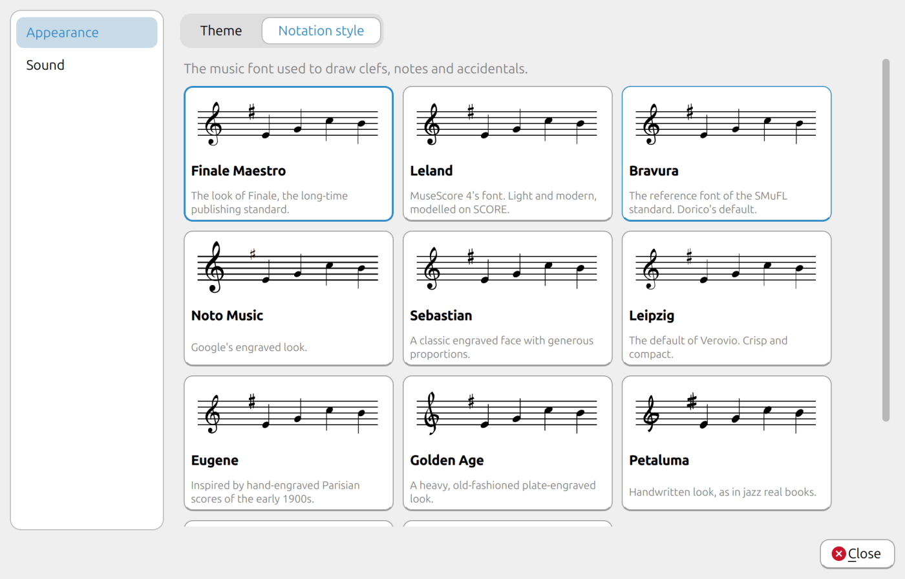
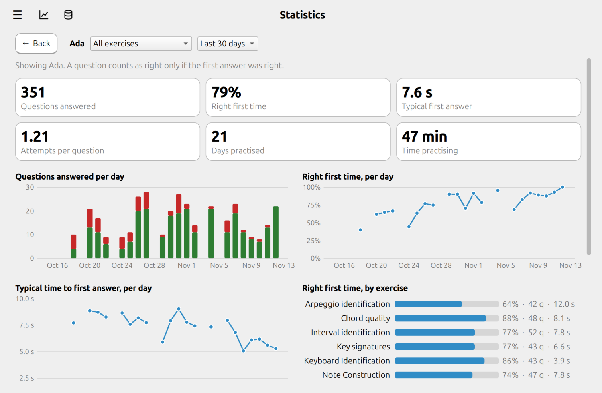
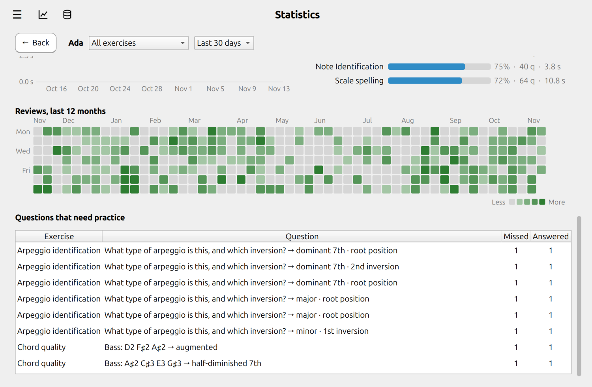

#  Alto

<table>
  <tr>
    <th scope="row" align="left">Testing</th>
    <td>
      <a href="https://github.com/altosaurus/alto/actions/workflows/tests.yml"></a>
      <a href="https://codecov.io/gh/altosaurus/alto"></a>
      <a href="https://github.com/altosaurus/alto/actions/workflows/ruff.yml"></a>
      <a href="https://github.com/altosaurus/alto/actions/workflows/pyright.yml"></a>
      <a href="https://pre-commit.com/"></a>
      <a href="https://github.com/altosaurus/alto/actions/workflows/performance.yml"></a>
      <a href="https://altosaurus.github.io/alto/"></a>
    </td>
  </tr>
  <tr>
    <th scope="row" align="left">Package</th>
    <td>
      <a href="LICENSE"></a>
      <a href="https://github.com/altosaurus/alto/releases"></a>
    </td>
  </tr>
  <tr>
    <th scope="row" align="left">Powered By</th>
    <td>
      <a href="https://github.com/altosaurus/alto/blob/main/.github/workflows/tests.yml"></a>
      <a href="https://doc.qt.io/qtforpython-6/"></a>
      <a href="https://numpy.org/"></a>
      <a href="https://pypi.org/project/fsrs/"></a>
      <a href="https://sqlite.org/"></a>
      <a href="https://apps.ankiweb.net/"></a>
    </td>
  </tr>
</table>

**Music theory practice with spaced repetition.**

Alto is a free desktop music theory trainer. Read notes on any clef, name intervals, chords and arpeggios, spell scales,
learn key signatures, and find keys on a keyboard. Your answers determine when each question comes back for review.

<p align="center">
  <picture>
    <source media="(prefers-color-scheme: dark)" srcset="docs/assets/img/circle-of-fifths-dark.png">
    
  </picture>
</p>

## Key Features

- **Note reading and intervals.** Identify notes across clefs, name the distance between two notes, or build an interval above or below a given note.
- **Scales, keys, and harmony.** Construct scales, work around the circle of fifths, and identify chords and arpeggios.
- **Rhythm.** Complete rhythmic equations with notes and rests. [Exercise guide](docs/exercises.md).
- **MIDI input on Linux.** Play answers on a USB MIDI keyboard or use the Virtual MIDI Piano Keyboard (VMPK). [MIDI setup](docs/exercises.md#midi-keyboard-input).
- **Anki export.** Export selected exercises as flashcards, including their SM-2 or FSRS review schedules. [Anki export guide](docs/data.md#anki-decks).

## Make it yours

Almost everything is adjustable.

- **Notation in the font you like.** Eleven music fonts, from the polished look of Finale Maestro, Leland and Bravura to
  handwritten jazz styles. Every staff in the app follows your choice.
- **Light, dark or follow your desktop.** The theme switches instantly.
- **Practice exactly what you need.** Choose the clefs (the grand staff, treble, bass, alto, tenor, soprano, mezzo-soprano or baritone), the range of
  notes, the key signatures, the note values from the double whole note to the thirty-second note, letter or solfège names, and
  whether sharps, flats and naturals appear.
- **Choose the sound.** Pick the instrument that plays your answers.

<p align="center">
  <picture>
    <source media="(prefers-color-scheme: dark)" srcset="docs/assets/img/settings-dark.png">
    
  </picture>
</p>

## Plugins

Plugins add instruments and practice material to Alto. Each one is an instrument pack in a single ZIP, and it can include:

- **Artwork and recordings** for the instrument, with an animation that shows each correct answer.
- **Exercises** that ask you to name a note on a fingerboard, find the interval between two highlighted keys on a keyboard,
  name an instrument's parts, or answer a knowledge check by clicking the picture.
- **Lessons and glossary entries**, linked to the plugin's exercises.
- **Extra views and settings**, such as the back of an instrument, a choice of sound, a note range, accidentals and the octave.
- **Keyboards** drawn in a look the plugin chooses, with a range selector and a choice of intervals and manuals.

Choose **Tools → Plugins** to see what is installed. You can install a registered plugin by its code or a downloaded ZIP,
update it, or uninstall it and keep your practice history. Installed exercises appear under **Instruments**.
The [viola](docs/plugins/viola.md) and [harpsichord](docs/plugins/harpsichord.md) tutorials each build a finished example pack.

## Spaced repetition

Choose a spaced repetition algorithm under **Settings → Practice**.

- **ASRS and ARTS** use accuracy and response time to choose the next question. If you hesitate over an interval,
  you may see it again sooner even when you name it correctly.
- **SM-2 and FSRS** give each question a review date based on your first answer each time you see it.
  Each exercise shows how many reviews are due and how many new cards are available that day.

Alto saves each answer in a local database under your profile. You can filter accuracy, response time, and practice
volume by exercise, see a year of practice on the calendar heatmap, or browse individual answers.
For a comparison, follow the same note through all four algorithms in the
[spaced repetition guide](https://altosaurus.github.io/alto/dev/practice/).

<p align="center">
  <picture>
    <source media="(prefers-color-scheme: dark)" srcset="docs/assets/img/stats-dark.png">
    
  </picture>
</p>

<p align="center">
  <picture>
    <source media="(prefers-color-scheme: dark)" srcset="docs/assets/img/stats-heatmap-dark.png">
    
  </picture>
</p>

## Free and open source

Alto is released under the [MIT License](LICENSE). There are no accounts and no tracking.
Your history is one SQLite file on your computer that you can back up, move or open with any SQLite tool. The bundled
music fonts and recordings all come with their licenses, listed in [THIRD_PARTY_NOTICES.md](THIRD_PARTY_NOTICES.md).

## Built for Linux

Linux is Alto's main platform. It is developed and tested there, follows your desktop's light or dark setting, and keeps
its files in the usual places (`~/.local/share/Alto` and `~/.config/alto`). It is a native Qt application, not a web
page in a wrapper. There is also a Windows installer, which is built and checked automatically but has had much less testing than
the Linux version. Alto may run on macOS too, but there is no package for it and it is not tested.

## Download

Each release on the [Releases page](https://github.com/altosaurus/alto/releases) has a Linux download and a Windows installer. They
carry their own Python and Qt, so nothing else needs to be installed. See
[Getting started](https://altosaurus.github.io/alto/latest/getting-started/) for how to install, update and uninstall them.

## Get started from the source

You need Python 3.11 or newer.

```bash
git clone https://github.com/altosaurus/alto.git
cd alto
python -m venv .venv
.venv/bin/pip install -e .
.venv/bin/python -m alto
```

The first time it opens, Alto asks you to create a profile. There is no password.

## Documentation

Guides for every exercise, how the practice scheduling works, the statistics, settings and shortcuts are in
[`docs/`](docs/) and published at https://altosaurus.github.io/alto/, with a version for each release and one for the development docs.

To package your own instrument artwork, recordings, exercises and lessons, start with the [Plugins](docs/plugins.md) page,
then follow the [viola](docs/plugins/viola.md) or [harpsichord](docs/plugins/harpsichord.md) plugin tutorial.

## Development

```bash
.venv/bin/pip install -e ".[dev]"
.venv/bin/pre-commit install     # commit checks, push checks, and merged local branch cleanup
.venv/bin/pytest
.venv/bin/ruff check alto tests
```

The theory, exercises and learning code have no Qt dependency, so they can be tested without a display. See
[Resources](docs/guide/index.md) for how the program works, and [For developers](docs/development.md) for commands and
recipes such as adding an exercise or a notation font.

## License

[MIT](LICENSE). The bundled fonts and recordings keep their authors' licenses; see
[THIRD_PARTY_NOTICES.md](THIRD_PARTY_NOTICES.md).
